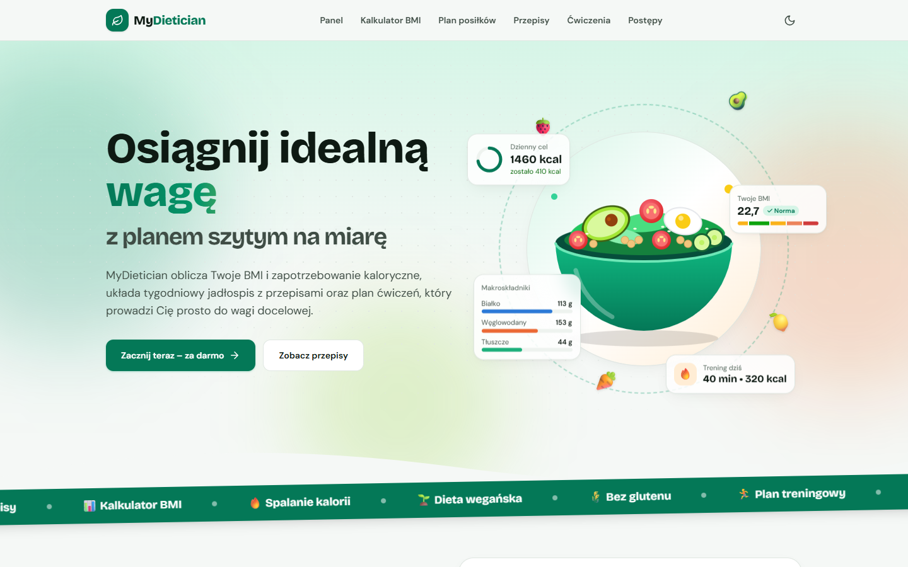
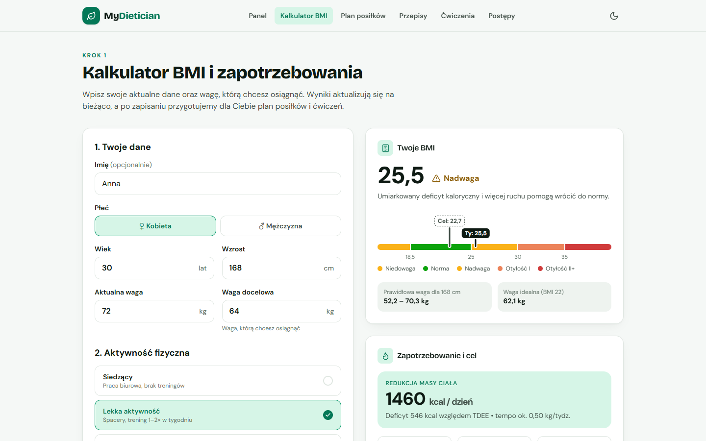
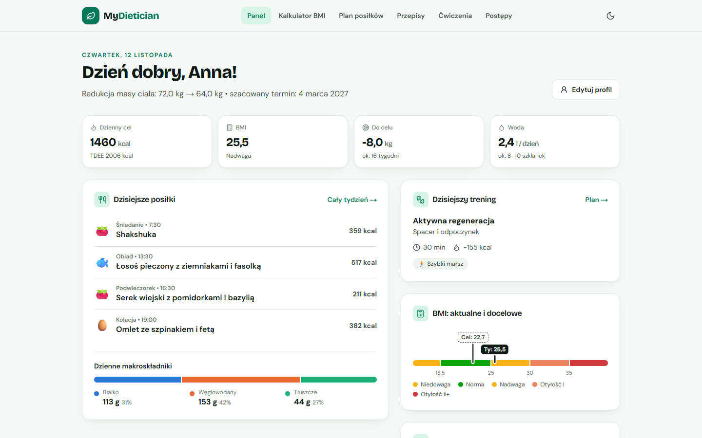
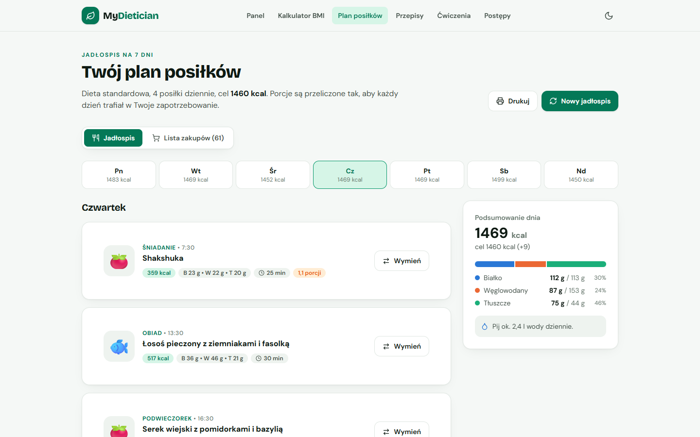
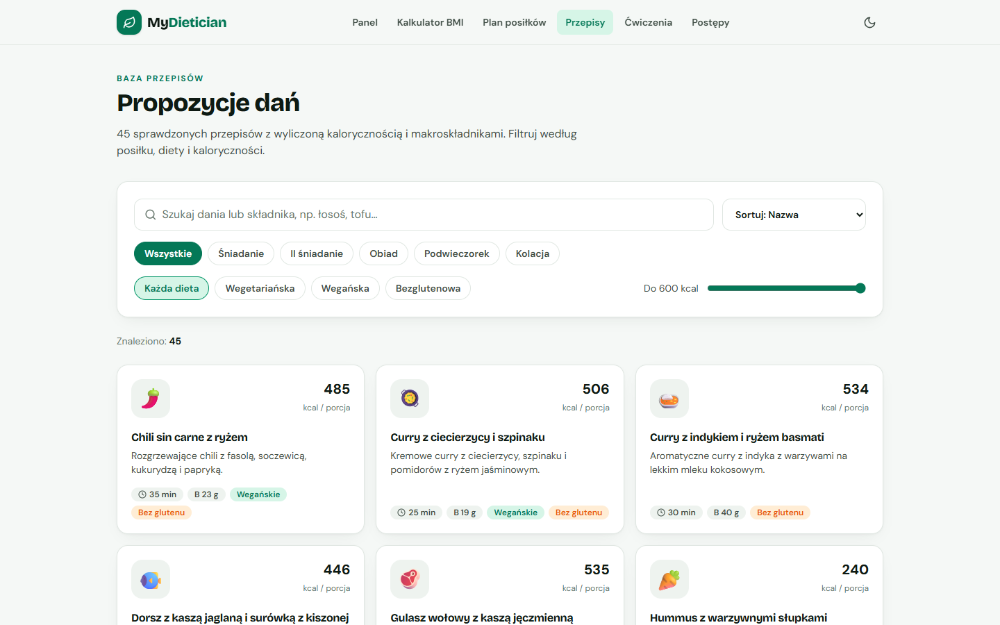
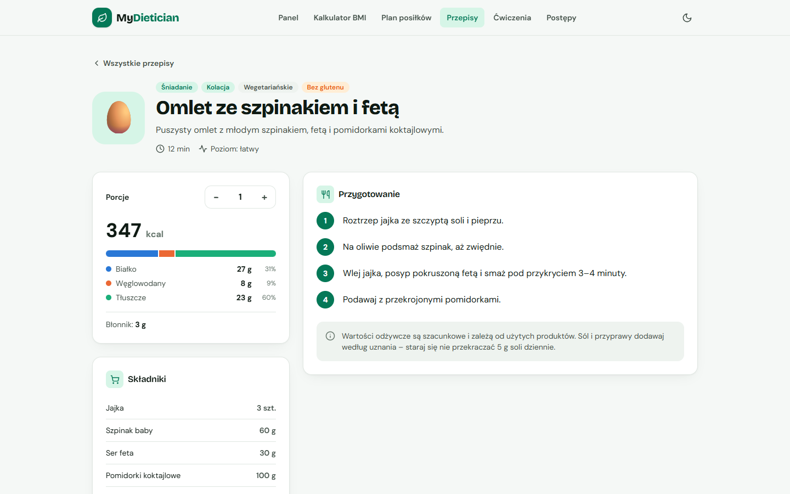
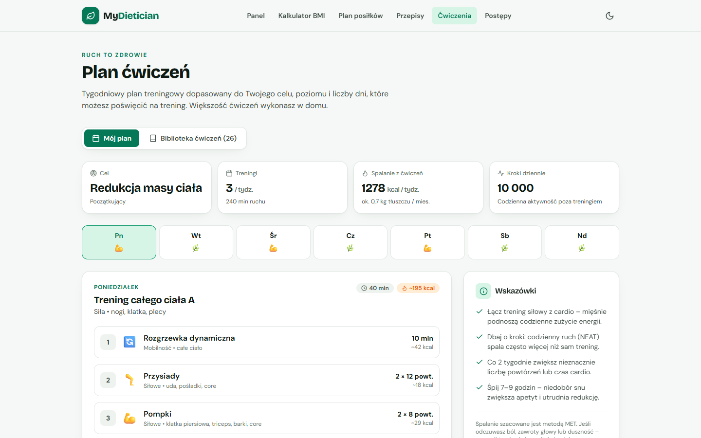
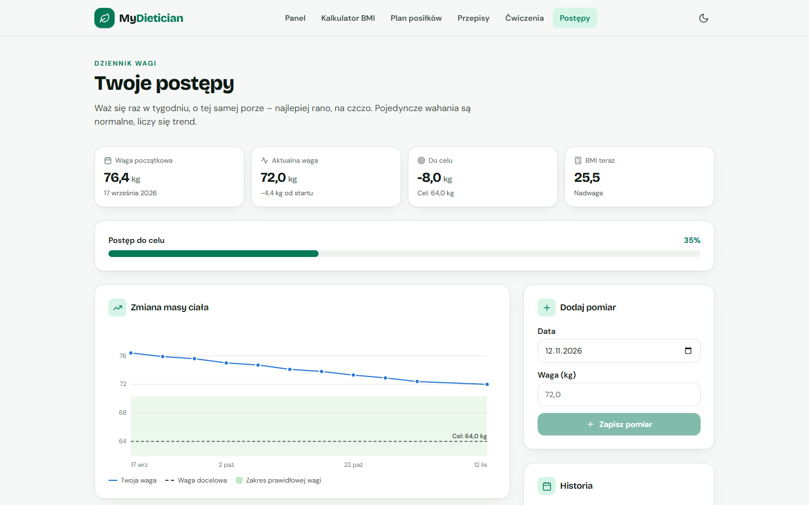
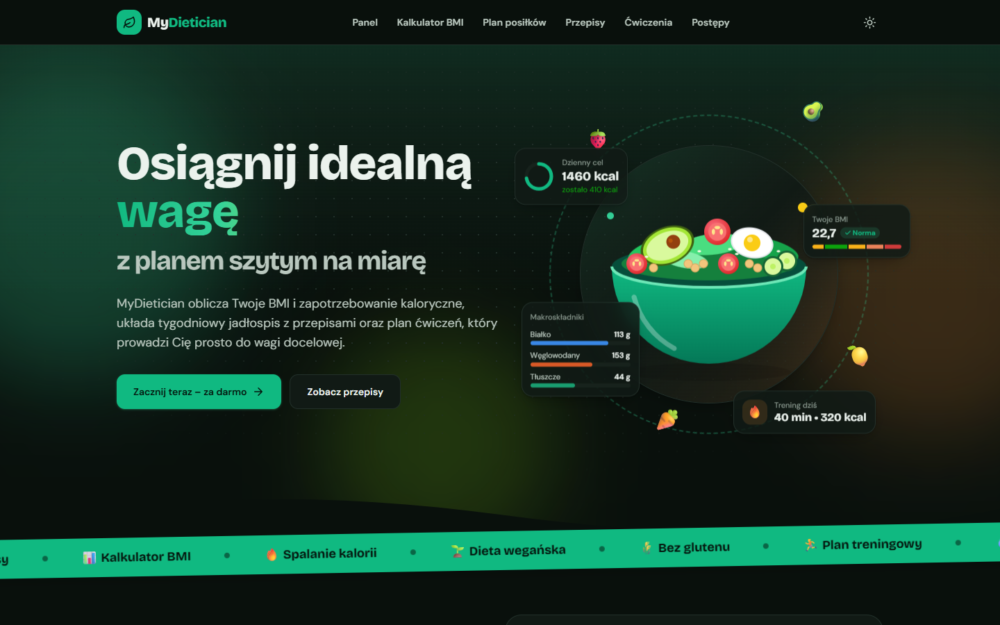
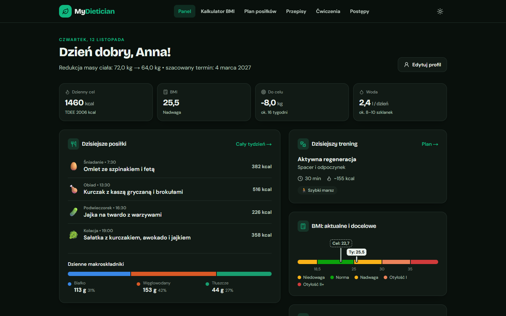

# MyDietician 🥗

[](https://github.com/goldipl/my-dietician/actions/workflows/nextjs.yml)

🔗 **Live demo: [goldipl.github.io/my-dietician](https://goldipl.github.io/my-dietician/)**

**Your personal online dietitian** – a Next.js web app that takes your sex, age, weight, height and target weight, and then:

- calculates your **BMI** (WHO classification), healthy weight range and ideal weight,
- works out your **calorie needs** (BMR via Mifflin-St Jeor, TDEE) and a safe deficit or surplus,
- sets daily **macros**, fiber and water intake,
- builds a **7-day meal plan** with portions scaled to your calories (shopping list included, swap any dish in one click),
- offers a **library of 45 recipes** with calories and macros,
- prepares a **weekly workout plan** (26 exercises: strength, cardio, HIIT, mobility) matched to your goal and level,
- keeps a **weight log** with a progress chart.

The user interface is in Polish.

## Screenshots

<table>
  <tr>
    <td width="50%" align="center">
      <br />
      <b>Landing page</b><br />
      <sub>Hero section with a quick BMI calculator further down the page</sub>
    </td>
    <td width="50%" align="center">
      <br />
      <b>BMI &amp; calorie calculator</b><br />
      <sub>Profile form with live BMI, healthy weight range and daily calorie target</sub>
    </td>
  </tr>
  <tr>
    <td width="50%" align="center">
      <br />
      <b>Daily dashboard</b><br />
      <sub>Today's meals, workout, macros and BMI – current vs. target</sub>
    </td>
    <td width="50%" align="center">
      <br />
      <b>7-day meal plan</b><br />
      <sub>Portions scaled to your calories, one-click meal swap, shopping list and print</sub>
    </td>
  </tr>
  <tr>
    <td width="50%" align="center">
      <br />
      <b>Recipe library</b><br />
      <sub>45 recipes – search and filter by meal, diet and calories</sub>
    </td>
    <td width="50%" align="center">
      <br />
      <b>Recipe details</b><br />
      <sub>Adjustable servings with macros, ingredients and step-by-step instructions</sub>
    </td>
  </tr>
  <tr>
    <td width="50%" align="center">
      <br />
      <b>Workout plan</b><br />
      <sub>Weekly plan matched to your goal and level, with estimated calories burned</sub>
    </td>
    <td width="50%" align="center">
      <br />
      <b>Progress tracking</b><br />
      <sub>Weight log with a chart, target line and healthy weight zone</sub>
    </td>
  </tr>
  <tr>
    <td width="50%" align="center">
      <br />
      <b>Dark mode – landing page</b><br />
      <sub>Light and dark themes, following the system setting or toggled manually</sub>
    </td>
    <td width="50%" align="center">
      <br />
      <b>Dark mode – dashboard</b><br />
      <sub>Every view supports both themes</sub>
    </td>
  </tr>
</table>

## Tech stack

| Layer | Technology |
|---|---|
| Framework | Next.js 16 (App Router, Turbopack), React 19 |
| Language | TypeScript (strict) |
| Styling | Tailwind CSS 4 (CSS color tokens, light and dark mode) |
| Validation | Zod 4 (one schema shared by the form and the API) |
| User data | `localStorage` – no sign-up, nothing leaves the browser |

## Getting started

```bash
npm install
npm run dev        # http://localhost:3000
npm run build      # production build
npm start          # production server
npm run typecheck  # type check
```

## Deployment

### GitHub Pages (static version)

Every push to `main` runs the [`.github/workflows/nextjs.yml`](.github/workflows/nextjs.yml) workflow, which builds a static export and publishes it to **https://goldipl.github.io/my-dietician/**.

One-time setup: **Settings → Pages → Build and deployment → Source: GitHub Actions**.

GitHub Pages only serves static files, so:
- the UI generates the meal plan and workout plan in the browser (the same functions the API uses),
- `src/app/api` is left out of this build – the REST API is not available on Pages,
- `scripts/flatten-rsc-segments.mjs` exposes Next.js prefetch payloads under the file names the client router requests.

Local preview of the export: `GITHUB_PAGES=true PAGES_BASE_PATH=/my-dietician npm run build` (temporarily remove `src/app/api` first).

### Node.js server / Vercel (full version with the API)

`npm run build && npm start` – all pages plus the REST API.

## Project structure

```
src/
├── app/
│   ├── page.tsx              # landing page + quick BMI calculator
│   ├── kalkulator/           # profile form + live results
│   ├── panel/                # daily dashboard
│   ├── plan-posilkow/        # 7-day meal plan, shopping list, print
│   ├── przepisy/[id]/        # recipe library (SSG) + portion scaling
│   ├── cwiczenia/            # workout plan + exercise library
│   ├── postepy/              # weight log with chart
│   └── api/                  # REST API (see below)
├── components/               # UI, charts (SVG), page views
└── lib/
    ├── nutrition.ts          # BMI, BMR, TDEE, calories, macros, safety rules
    ├── mealPlan.ts           # meal plan generator (deterministic seed)
    ├── workoutPlan.ts        # workout plan generator (MET-based)
    ├── schema.ts             # Zod profile schema
    └── data/                 # recipes and exercises
```

## REST API

All endpoints accept and return JSON. Validation errors return `422` with a `details` field.

The **profile** object (`profile`):

```json
{
  "sex": "female",            // female | male
  "age": 30,                  // 16–100
  "weight": 72,               // kg, 35–300
  "height": 168,              // cm, 130–230
  "targetWeight": 64,         // kg
  "activity": "light",        // sedentary | light | moderate | active | very_active
  "pace": 0.5,                // kg/week, 0.25–1
  "diet": "standard",         // standard | vegetarian | vegan | gluten_free
  "mealsPerDay": 4,           // 3 | 4 | 5
  "fitnessLevel": "beginner", // beginner | intermediate | advanced
  "trainingDays": 3           // 2–6
}
```

| Method | Path | Description |
|---|---|---|
| `GET` | `/api/health` | Service status |
| `GET` / `POST` | `/api/bmi?weight=80&height=180` or `{ weight, height }` | BMI, category, healthy weight range |
| `POST` | `/api/nutrition` `{ profile }` | BMR, TDEE, calories, macros, water, goal date, warnings |
| `POST` | `/api/meal-plan` `{ profile, seed? }` | 7-day meal plan + shopping list (same `seed` = same plan) |
| `POST` | `/api/workout-plan` `{ profile }` | Weekly workout plan with estimated calories burned |
| `GET` | `/api/recipes?meal=lunch&diet=vegan&q=tofu&maxKcal=600` | Filtered recipe list |
| `GET` | `/api/recipes/:id` | Recipe details |
| `GET` | `/api/exercises?category=strength&level=beginner` | Exercise list |

Example:

```bash
curl -X POST http://localhost:3000/api/nutrition \
  -H "Content-Type: application/json" \
  -d '{"profile":{"sex":"female","age":30,"weight":72,"height":168,"targetWeight":64,"activity":"light","pace":0.5,"diet":"standard","mealsPerDay":4,"fitnessLevel":"beginner","trainingDays":3}}'
```

## How it calculates

- **BMR** – Mifflin-St Jeor: `10·weight + 6.25·height − 5·age + (5 ♂ | −161 ♀)`
- **TDEE** – BMR × activity factor (1.2–1.9)
- **Deficit/surplus** – `pace × 7700 kcal / 7` per day
- **Protein** – 1.6 g/kg (weight loss), 1.3 g/kg (maintenance), 1.8 g/kg (muscle gain); for overweight users it is based on the weight at BMI 25
- **Fat** – 27–28% of energy, **carbs** – the rest
- **Calories burned in workouts** – `MET × weight × time` (Compendium of Physical Activities)

### Safety rules

- calories never go below 1200 kcal (women) / 1500 kcal (men),
- weight loss is capped at ~1% of body weight per week, weight gain at 0.5 kg/week,
- no weight-loss plan below the lower healthy-weight limit (BMI 18.5) – for underweight users the plan switches to maintenance,
- warnings for users under 18 and for BMI < 17 or ≥ 35.

> ⚠️ MyDietician is for educational purposes only and does not replace advice from a doctor or a clinical dietitian.
